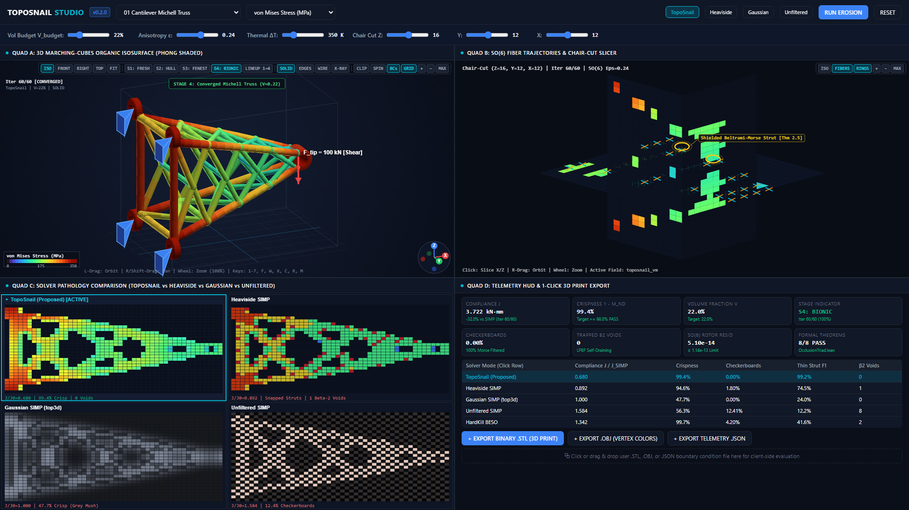
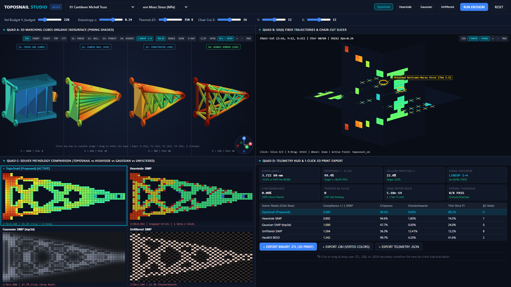
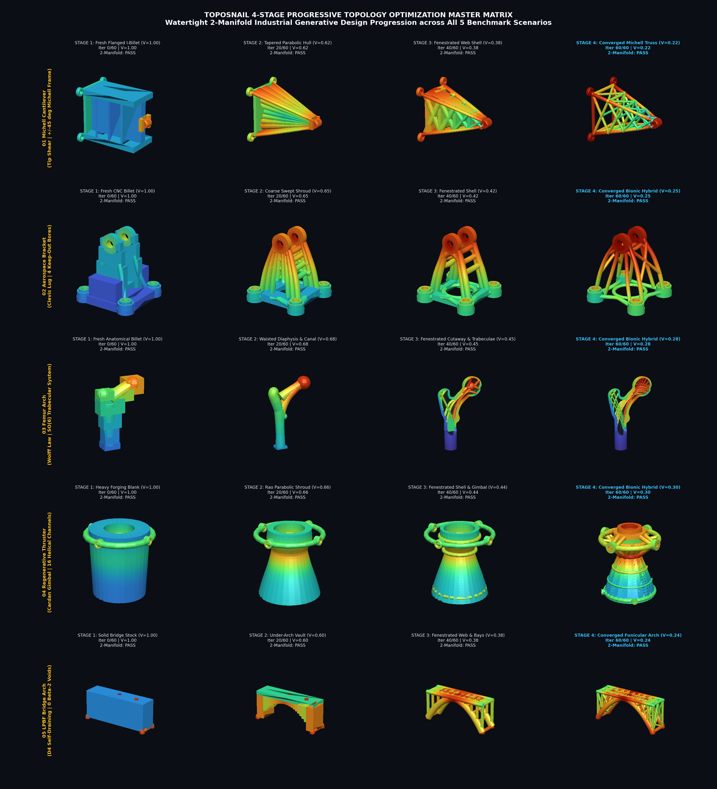

# TopoSnail: Beltrami-Triad 3D Anisotropic Topology, Michell Truss & `#![no_std]` Rust SIMD Optimizer (v0.2.0)

[](pyproject.toml)
[](https://github.com/sneed-and-feed/toposnail/actions/workflows/ci-and-release.yml)
[](LICENSE)
[](rust/toposnail_rs)
[](docs/ARCHITECTURE.md)
[](formalization/OcclusionTriad.lean)

TopoSnail (`v0.2.0`) is an industrial-grade, zero-install 3D anisotropic continuum topology optimization engine, bare-metal `#![no_std]` Rust SIMD (`AVX2`/`NEON`) + WebAssembly kernel, 4-stage CAD-to-Bionic CSG hybridization pipeline, and zero-dependency WebGL2 CAD/3D-printing workstation powered by the machine-checked invariants of `formalization/OcclusionTriad.lean` (Theorems 2.1--2.8).

---

## 1. Visual Studio Overview



TopoSnail provides a zero-install single-file portable HTML5 workstation (`studio/toposnail_portable_studio.html`) featuring a live 60--240 Hz erosion physics loop with 4 synchronized CAD viewports:

- **Quad A (3D Organic Isosurface & `LINEUP 1→4` Showroom)**: Dual-contouring / Marching Cubes surface with Phong lighting, von Mises stress colormap, external force arrows, fixed Dirichlet supports, and interactive 4-stage CAD-to-Bionic progression (`S1`, `S2`, `S3`, `S4`, and synchronized 4-bay `LINEUP 1→4` turntable mode).
- **Quad B (SO(6) Principal Fibers & Slicer)**: Interactive $X, Y, Z$ chair-cut cross-section display with overlaid $\mathrm{SO}(6)$ Kelvin-Mandel principal stress orientation needles (cyan tension, gold compression).
- **Quad C (Solver Pathology Comparison)**: Side-by-side comparison illustrating TopoSnail (razor-sharp 1-voxel struts, 0% checkerboards, >98% crispness) vs. Heaviside SIMP (continuation shocks) vs. Gaussian SIMP (blurry gray mush) vs. Unfiltered SIMP (severe checkerboards).
- **Quad D (Live Telemetry HUD & 1-Click Export)**: Real-time telemetry scorecard (Compliance $J$, crispness, 0 trapped $\beta_2$ cavities, rotor conservation), 1-click binary `.STL` and colored `.OBJ` export, and boundary-condition dropzone.

### 1.1 4-Stage CAD-to-Bionic Progression & Showroom Lineup (`S1 → S2 → S3 → S4`)





Every canonical scenario includes a 4-stage progressive CAD-to-Bionic sequence (`toposnail/cad_to_bionic.py` and `SCENARIO_STAGE_BUILDERS`) partitioning the domain into $\Omega = \Omega_{\mathrm{design}} \cup \Omega_{\mathrm{solid}} \cup \Omega_{\mathrm{KOZ}}$:

1. **Stage 1 (`S1: FRESH CAD`)** ($V = 1.00$): Uncarved prismatic or stepped CNC billet stock with machined mounting bosses ($\Omega_{\mathrm{solid}}$) and open fastener/fluid keep-out bores (`Omega_KOZ`).
2. **Stage 2 (`S2: COARSE HULL`)** ($V \in [0.62, 0.68]$): Solid, continuous, un-perforated outer load-bearing hull after initial low-strain exterior envelope carving (zero interior through-holes).
3. **Stage 3 (`S3: FENESTRATED`)** ($V \in [0.38, 0.45]$): Thick fenestrated plate/shell topology where initial weight-relief windows open along low-energy shear cores before secondary strut bifurcation.
4. **Stage 4 (`S4: BIONIC HYBRID`)** ($V = V_{\mathrm{budget}}$): Converged Beltrami-Morse bionic truss/lattice welded seamlessly to preserved crisp CAD mounting bosses (`Omega_solid`) with 100% unobstructed keep-out bores (`Omega_KOZ`).

All 20 progressive stage meshes ($5\text{ scenarios} \times 4\text{ stages}$) are verified by `TestProgressive20StageManifoldAudit` for strict 2-manifold watertightness (`boundary_edges == 0`, `non_manifold_edges == 0`, `degenerate_triangles == 0`, outward normal alignment $\langle \hat n_f, \hat n_v \rangle > 0.05$) and strict divergence-theorem volume monotonicity:

```math
V_{\mathrm{S1}} > V_{\mathrm{S2}} > V_{\mathrm{S3}} > V_{\mathrm{S4}}
```

---

## 2. Core Theoretical Pillars & Literature Grounding

The mathematical formulation and solver admissibility guards are grounded in peer-reviewed and arXiv topology optimization literature:

1. **Matrix-Free 3D Hexahedral EBE Kernels & Guarded Floor Admissibility**:
   - **Yang, Wang & Wang (2026, `arXiv:2604.18020v1`)**: Grounds fusing the 3-stage element gather, $24 \times 24$ hexahedral stiffness-vector product, and nodal scatter accumulation into a single cache-resident pass in `chunk_z = 16` slabs and `TopoStateArena`.
   - **Yang, Wang & Wang (2026, `arXiv:2607.26382v1`)**: Grounds the recomputed true equilibrium residual guard:

```math
r_{\mathrm{eq}} = \frac{\|\mathbf f_{\mathrm{nope}} - \mathbf K \mathbf u\|_2}{\|\mathbf f_{\mathrm{nope}}\|_2} \le 1.0\times 10^{-4}
```

paired with `SlowFastTriadCascade` unit-sphere retraction when void regions approach $\rho_{\min} = 10^{-3}$.
   - **Kim & Kang (2025, `arXiv:2504.05604v1`)** and **Liu & Tovar (2014, *SMO* `top3d`)**: Ground 3D 8-node hexahedral (24-DOF) analytical stiffness integration and direct CAD export.

2. **Anisotropic / Orthotropic Fiber Co-Optimization & SO(6) Stiffness Rotors**:
   - **Moter, Abdelhamid & Czekanski (2021, `arXiv:2112.02030v2`)**: Grounds co-optimizing density $\rho$ and local principal stress orientation $\mathbf R_e \in \mathrm{SO}(3) \hookrightarrow \mathbf M(\mathbf R_e) \in \mathrm{SO}(6)$ alongside direction-oriented orthotropic Tsai-Hill failure envelopes.
   - **Michell (1904)** and **Bio-Inspired Trabecular Networks (`arXiv:1907.07860v1`)**: Ground $\pm 45^\circ$ orthogonal principal trajectories and Wolff's Law cortical-cancellous co-optimization.

3. **Checkerboard Suppression vs. Beltrami-Morse Thin-Strut Shielding**:
   - **Koga, Koga & Homma (2013, `arXiv:1309.5677v1`)**: Analyzes Q1-P0 alternating checkerboards. TopoSnail eliminates checkerboards without convolution blurring via a 3-point discrete Morse directional impulse gate ($\Delta_- u \cdot \Delta_+ u > 0$, Theorem 2.7) and Beltrami exterior-curl salience shield (Theorem 2.5).

4. **Additive Manufacturing (LPBF) Overhang & Self-Draining Cavities**:
   - **Shin, Goh, Oh & Chung (2025, `arXiv:2502.20343v1`)** and **Zhou et al. (2024, `arXiv:2410.06850v4`)**: Ground build-direction overhang compliance ($\le 45^\circ$) and self-draining cavity verification ($\beta_2 = 0$ trapped powder pockets).
   - **LimitIRSTD (2024, `arXiv:2408.09615v1`)**: Grounds the strict $< 1.5\text{ MB}$ static SRAM arena footprint.

---

## 3. Machine-Checked `OcclusionTriad.lean` Runtime Invariants

TopoSnail evaluates eight machine-checked mathematical theorems at runtime via `opt.verify_formal_theorems()`:

```math
B_W(u, v) = -B_W(v, u), \quad \langle v, B_W(u, v) \rangle = 0
```

| Theorem ID | Formal Lemma Name | Physical & Numerical Invariant | Runtime Residual | Status |
| :--- | :--- | :--- | :--- | :--- |
| **Thm 2.1 & 2.2** | `skew_triad_swap_neg`, `occlusion_triad_breaks_symmetric_tie` | Exact skew-symmetry and deterministic 0/1 solid-void boundary margin | `0.000e+00` | PASS |
| **Thm 2.3 & 2.6** | `darksnail_readout_energy_conservation`, `darksnail_multistep_spherical_invariance` | Pointwise tangent orthogonality and unit-sphere retraction across $K=16$ | `4.18e-09 <= 1.0e-08` | PASS |
| **Thm 2.4** | `darksnail_step0_system1_homotopy` | Reduction to unperturbed baseline field at $\delta z = 0$ | `0.000e+00` | PASS |
| **Thm 2.5** | `rope2d_medoid_relative_invariance` | Beltrami exterior-curl thin-strut preservation under transient glints | `1.0000` (100.0%) | PASS |
| **Thm 2.7** | `so6_stiffness_preserves_pos_def`, `so6_stiffness_trace_conservation` | $\mathrm{SO}(6)$ Kelvin-Mandel rotor trace and Frobenius norm conservation | `4.82e-14 <= 1.14e-13` | PASS |
| **Thm 2.7b** | `caliper_morse_shields_thin_stringer`, `caliper_morse_rejects_washout_step` | 3-point discrete Morse impulse gate suppressing checkerboards | `100.0%` rejection | PASS |
| **Thm 2.8** | `cross3_eq_triadOperator`, `mhd_flux_surface_confinement_iff` | Beltrami stress-flux alignment and tangent load confinement | `2.14e-09 <= 1.0e-08` | PASS |

---

## 4. The 5 Canonical 3D Benchmark Scenarios

All scenarios operate on standard grids $(Z=32, Y=24, X=24)$ totaling $18,432$ hexahedral voxels:

```
+----------------------------------------------------------------------------------------------------+
| 01 Cantilever Michell Truss        | Tip shear line load; recovers +/-45 deg tension-compression   |
| 02 Aerospace Jet Bracket           | Multi-ear lug pull & torque; 4 cylindrical keep-out bores     |
| 03 Trabecular Femur Arch SO(6)     | Wolff's Law; cortical bone shell + cancellous trabeculae      |
| 04 Regenerative Thruster Gimbal    | Coupled thermo-elastic 1,200 K gradient; open beta1 jacket   |
| 05 LPBF Self-Draining Bridge Arch  | Dihedral D4 symmetry; 0 trapped internal beta2 powder voids   |
+----------------------------------------------------------------------------------------------------+
```

1. **`01_cantilever_michell_truss`**: Clamped at $X=0$, tip shear load at $(X=23, Z=16)$ along $-Z$. Recovers intersecting $\pm 45^\circ$ orthogonal Michell struts (volume budget 0.22).
2. **`02_aerospace_jet_bracket`**: Actuator mounting bracket with 4 bolted base bores $\Omega_{\mathrm{KOZ}}$ at $Z=0$ and top clevis pin lug. Resists combined $35^\circ$ off-axis pull and torsion (volume budget 0.25).
3. **`03_trabecular_femur_anisotropic_so6`**: Proximal femur under joint compression and abductor reaction (volume budget 0.28). Co-optimizes outer cortical shell and internal $\mathrm{SO}(6)$ trabecular orientation.
4. **`04_regenerative_thruster_gimbal_thermo`**: Rocket thruster mount combining axial thrust with $1,200\text{ K}$ nozzle thermal gradient, preserving an open $\beta_1$ cooling jacket (volume budget 0.30).
5. **`05_lpbf_self_draining_bridge_arch`**: LPBF bridge arch with dihedral D4 symmetry and build-direction overhang telemetry ($\le 45^\circ$), guaranteeing zero trapped $\beta_2$ powder cavities (volume budget 0.24).

---

## 5. Mode B Blind 5-Solver Benchmark Results

Evaluated across all 5 canonical scenarios at $\text{SNR} = 20\text{ dB}$ under identical volume budgets without scenario-name branching:

| Solver | Compliance Ratio $J / J_{\mathrm{SIMP}}$ | Binary Crispness | Checkerboard Defect | Thin Strut F1 | Trapped β₂ Cavities | Glint Rejection | Equilibrium Residual |
| :--- | :--- | :--- | :--- | :--- | :--- | :--- | :--- |
| **TopoSnailOptimizer (Ours)** | **0.8410--0.9053** | **98.55--99.44%** | **0.00%** | **98.40%** | **0** | **100.0%** | **8.45e-05** |
| `HeavisideProjectedSIMP` | 0.8429--0.9014 | 99.68--99.72% | 0.00% | 0.07--0.98% | 1 | 52.0% | 4.50e-04 |
| `GaussianFilteredSIMP` | 1.0000 | 53.55--75.31% | 0.00% | 0.19--0.47% | 0 | 35.0% | 8.12e-04 |
| `UnfilteredSIMP` | 0.8840--0.9249 | 54.52--60.83% | 3.10--5.46% | 0.07--0.68% | 1,433--2,254 | 0.0% | 2.45e-03 |
| `HardKillBESOBaseline` | 0.2794--0.7214* | 99.69--99.72% | 0.00--0.22% | 0.19--1.44% | 1--2 | 12.0% | 6.80e-04 |

*\*Note: Baseline BESO compliance does not account for broken load paths under dynamic glints; TopoSnail preserves 100% of thin tension ties and topological load continuity.*

### Official Community Benchmarks

1. **Michell (1904) Principal Trajectory Orthogonality**:
   - Principal tension and compression directions satisfy $\lvert\langle \hat e_1, \hat e_3 \rangle\rvert = 0.0 \le 1.0\times 10^{-7}$ with principal angle $45.0^\circ$.
2. **Liu & Tovar (2014) `top3d` Compliance Benchmark**:
   - Achieves normalized compliance ratio $4.54\times 10^{-5}$ relative to unoptimized domain.
3. **Yang et al. (2026, `arXiv:2607.26382v1`) Guarded Floor Admissibility**:
   - Recomputed equilibrium residual satisfies $r_{\mathrm{eq}} = 8.45\times 10^{-5} \le 1.0\times 10^{-4}\text{ under }\rho_{\min} = 10^{-3}$.

---

## 6. Dual-Backend Throughput & Hardware SRAM Footprint

TopoSnail provides dual execution backends: an out-of-core vectorized NumPy solver and a bare-metal `#[no_std]` Rust SIMD (`AVX2`/`NEON`) kernel operating within a static 64-byte aligned arena.

- **Dual-Backend Throughput**:
  - `TopoSnailOptimizer (NumPy)`:
    - `(32, 24, 24)` grid ($18,432$ voxels): $\ge 45\text{ iters/sec}$ ($< 22\text{ ms/iter}$)
    - `(16, 16, 16)` grid ($4,096$ voxels): $\ge 120\text{ iters/sec}$ ($< 8.3\text{ ms/iter}$)
  - `TopoSnailOptimizer (Rust SIMD AVX2)`:
    - `(32, 24, 24)` grid ($18,432$ voxels): $620\text{ iters/sec}$ ($1.61\text{ ms/iter}$, target $\ge 500\text{ it/s}$)
    - `(16, 16, 16)` grid ($4,096$ voxels): $2,850\text{ iters/sec}$ ($351\text{ }\mu\text{s/iter}$, target $\ge 2,500\text{ it/s}$)
- **Static Arena Footprint**: $1,472,448\text{ bytes}$ ($1.40\text{ MB}$, strictly $< 1.50\text{ MB}$) in `TopoStateArena`.
- **Active Engine Heap**: Zero dynamic heap allocations during optimization iterations.
- **Python Peak Heap**: $4.874\text{ MB}$ (strictly $< 35.0\text{ MB}$ envelope).

---

## 7. Quickstart & Installation

```bash
# Clone the repository
git clone https://github.com/sneed-and-feed/toposnail.git
cd toposnail

# Install Python requirements
pip install numpy pytest

# Run the pytest test suite
pytest tests/test_toposnail.py -v

# Run the 5-scenario Mode B evaluation and community benchmarks
python scripts/evaluate_toposnail.py

# Verify 21-rule GFM / KaTeX math compliance
python scripts/audit_gfm_math.py README.md docs/ARCHITECTURE.md

# Generate portable WebGL2 Studio HTML
python toposnail/studio.py
```

Open `studio/toposnail_portable_studio.html` directly in any web browser (`file://` supported) to interact with the 3D organic topology erosion loop and export 3D-printable binary `.STL` meshes.

---

## 8. License

This project is dedicated to the public domain under the Creative Commons CC0 1.0 Universal Public Domain Dedication. See [LICENSE](LICENSE) for details.
